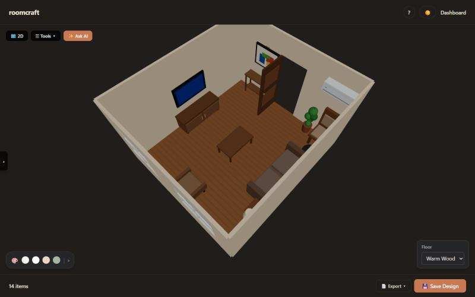
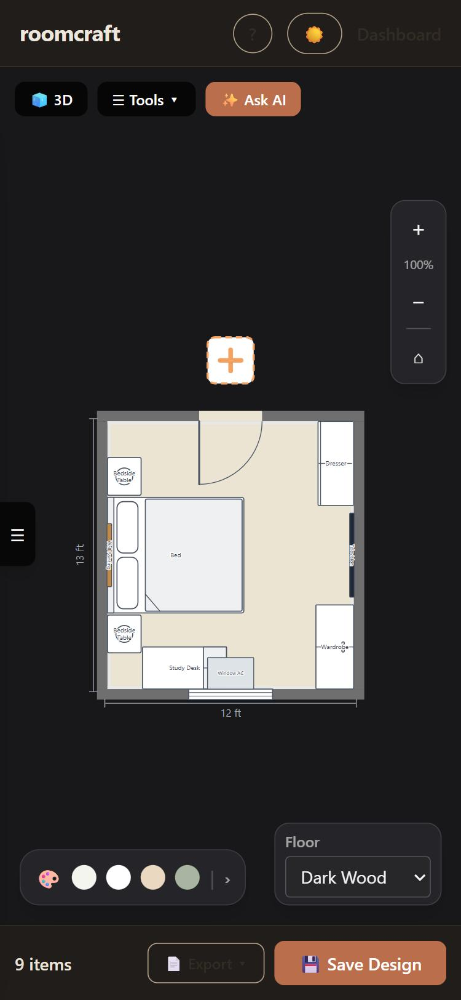
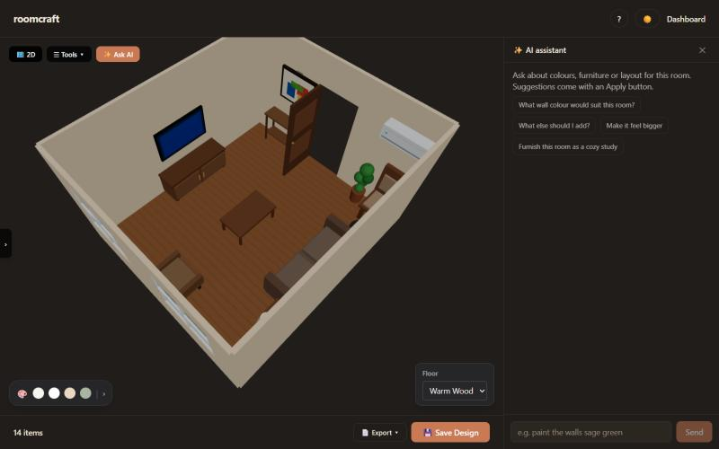
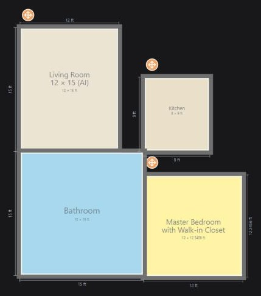

# roomcraft

**Scan a real room with your phone, design it in 2D and 3D, and furnish it with an AI assistant.**

**Live demo:** https://roomcraft-ivory.vercel.app. Press **✨ Try the demo** for a private sample account with three furnished rooms, no sign-up needed.



roomcraft is a full-stack web app for planning a room. An Android phone measures the room through the camera, in the browser (WebXR augmented reality). The editor turns it into a floor plan and a 3D model where furniture can't overlap, leave the room or block a door. An AI assistant takes requests in plain English ("furnish this as a cozy study") and applies changes only when you tap Apply.

## Features

- **AR room scanner (WebXR):** tap the corners of each wall to measure the room's size and ceiling height, then add doors, windows and furniture. It works in Chrome on Android with ARCore and needs no app install. In testing, a ceiling measured 2.72 m against 2.74 m by tape.
- **2D and 3D editor:** 14 room types and 86 furniture types. You can drag pieces, rotate them to any angle (they snap straight near 90°), give sizes to any decimal, and connect rooms through doors. Every piece and room is labelled with its size.
- **Placement rules:** pieces keep a gap from each other, sit flush against walls and stay out of door swings. The same rules are used by the editor, the room generator, the AI and the scanner.
- **✨ Ask AI (Google Gemini):** suggestions for colours, furniture and whole layouts, each with Apply and Undo. The model only chooses from the app's catalogue; the app does all the placing, so AI-made rooms follow the same rules.
- **Guess from camera:** during a scan, an on-device detector (MediaPipe) and Gemini suggest what a piece of furniture is.
- **PDF floor plans:** A4 export with every piece labelled and size lines on every room.
- **Accounts:** sign-up, JWT login, profile with photo, saved designs.
- **Works on phones and laptops**, in light and dark themes, with an 8-step guided tour.

| Phone: 2D plan | Ask AI beside the room | Floor plan export |
|---|---|---|
|  |  |  |

## Tech stack

| Part | Technology |
|---|---|
| Frontend | React 19, Vite, Tailwind CSS, three.js (React Three Fiber, drei) |
| Backend | Node.js, Express, PostgreSQL, JWT, bcrypt |
| AR scanner | WebXR (immersive-ar, hit test, anchors), three.js, MediaPipe Tasks Vision |
| AI | Google Gemini with JSON schemas (assistant and camera guess) |
| Hosting | Vercel (site + serverless API), Neon (PostgreSQL) |

```
browser (laptop or phone)
   │  one HTTPS address
   ▼
Vercel ── static site: React app (/) and AR scanner (/scan.html)
   └──── serverless function (api/index.js) → Express API (backend/) ──► Neon PostgreSQL
                                                    └──────────────────► Google Gemini
```

## About this repository

roomcraft was built as a **college team project**. This repository is my personal portfolio copy of it, prepared for a public live demo. My work on the project:

- the **AR room scanner**: measuring geometry, the guided scan, saving scans into the app;
- the **AI assistant** (plain-English room changes with Apply/Undo) and the **camera furniture guess**;
- integrating the scanner into the app, the phone layout, the 2D plan labels and the PDF export;
- this deployment (Vercel + Neon), the demo account and the documentation.

Changes made only in this copy, for the live demo:
- sign-up doesn't need an email code;
- profile photos are stored in the database, because the hosting has no permanent disk;
- the camera guess runs in the backend;
- there's a one-click demo account.

The project report and presentation are in [`docs/`](docs/).

## Run it locally

You need Node 20+ and PostgreSQL. With Docker:

```bash
docker run -d --name roomcraft-db -e POSTGRES_PASSWORD=choose-a-password -p 5433:5432 postgres:16
```

```bash
cd backend
npm install
cp env.example .env      # set DATABASE_URL and JWT_SECRET (and GEMINI_API_KEY for the AI)
npm run setup-db
npm run dev              # http://localhost:5000
```

```bash
cd frontend
npm install
npm run dev              # http://localhost:5173 (use "npm run dev:wifi" to scan from a phone over HTTPS)
```

## Deploying (Vercel)

`vercel.json` builds the frontend and serves the Express API as one serverless function under `/api`. The tables are created automatically on the first request to a new database. Set these environment variables on the Vercel project:

| Variable | Value |
|---|---|
| `DATABASE_URL` | Neon connection string (pooled) |
| `JWT_SECRET` | a long random string |
| `GEMINI_API_KEY` | Google AI Studio key (free tier) |
| `DEMO_MODE` | `true`: sign-up without email codes, demo login on |
| `NODE_ENV` | `production` |
